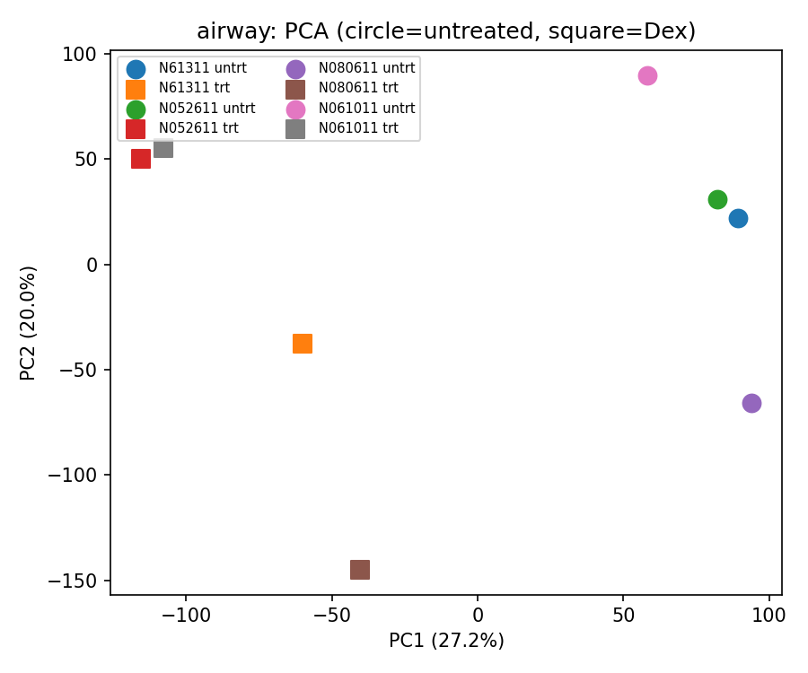
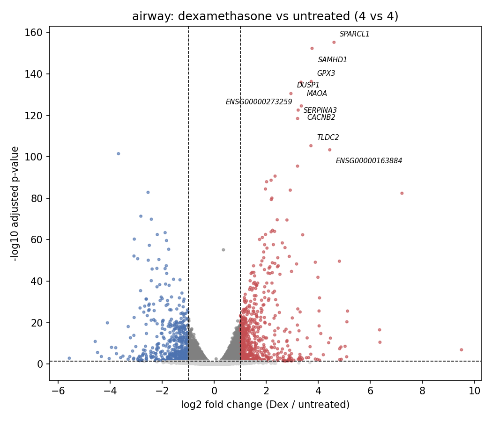
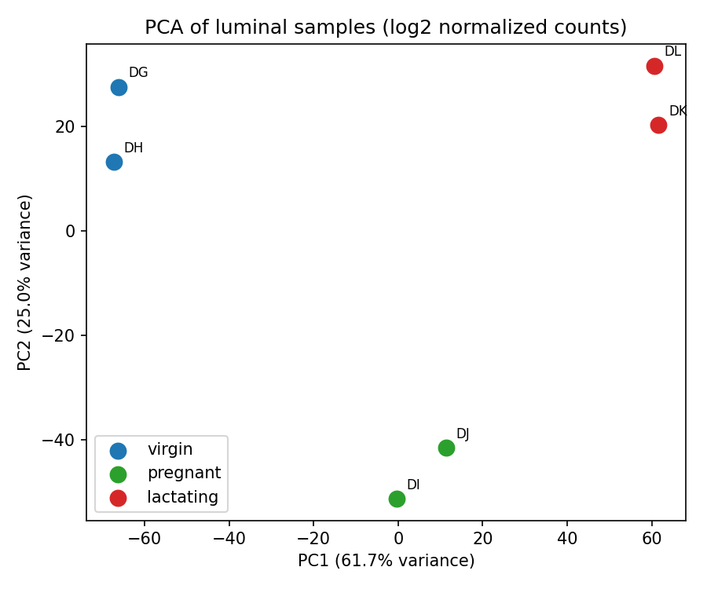
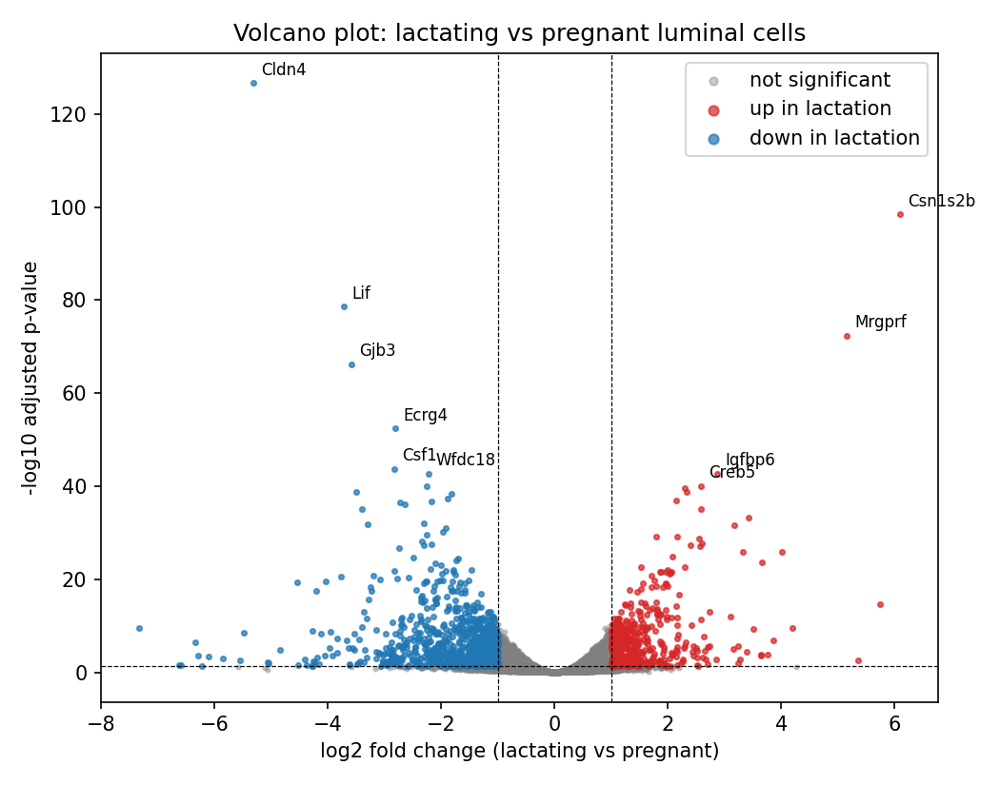
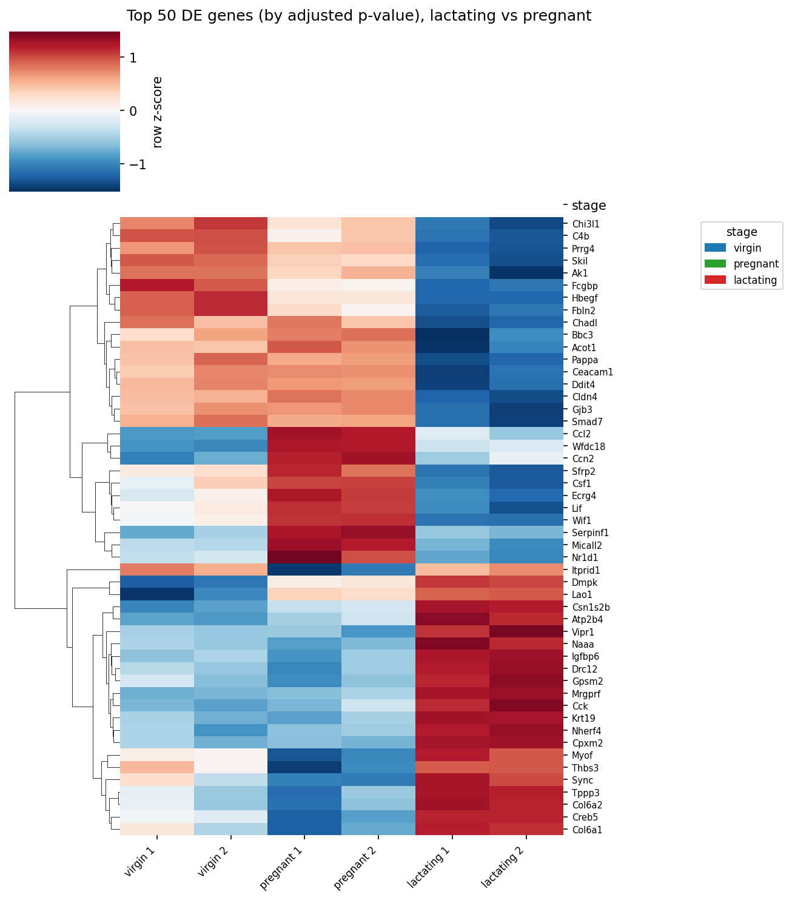
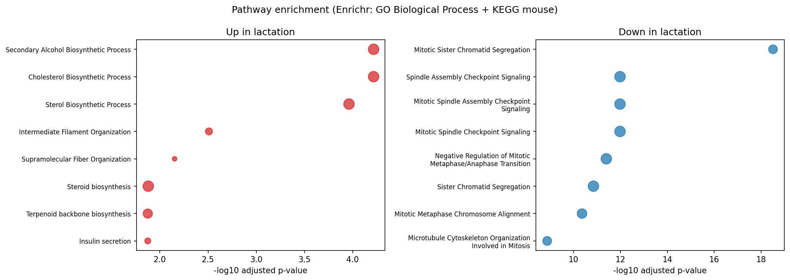

# RNA-seq Differential Expression Analysis

A complete, reproducible differential expression project on real public data:
download -> QC -> DESeq2 statistics -> PCA / volcano / heatmap -> pathway enrichment.

**Dataset:** [GSE60450](https://www.ncbi.nlm.nih.gov/geo/query/acc.cgi?acc=GSE60450) - Fu et al. 2015,
*Nature Cell Biology* (PMID 25730472). Mouse mammary gland, luminal and basal cells,
three stages (virgin, 18.5-day pregnancy, 2-day lactation), 2 replicates each.
Raw gene-level counts are downloaded directly from GEO.

**Primary comparison (prespecified):** lactating vs pregnant **luminal** cells (2 vs 2 replicates).

**Second dataset (better replicated):** the canonical `airway` benchmark -
[Himes et al. 2014](https://www.ncbi.nlm.nih.gov/geo/query/acc.cgi?acc=GSE52778) (GSE52778,
counts via [recount3](https://rna.recount.bio/), study SRP033351). Human airway smooth
muscle cells, dexamethasone vs untreated, **4 vs 4 replicates**, design `~ cell_line + treatment`
(the DESeq2 vignette design). This gives DESeq2 a much better basis for dispersion
estimation than the 2 vs 2 primary contrast.

## Results at a glance

| Metric | Value |
|---|---|
| Genes in raw matrix | 27,179 |
| Genes after low-count filtering (>=10 counts in >=2 samples) | 15,264 |
| Genes with adjusted p-values (after independent filtering) | 14,968 |
| Significant DE genes (padj < 0.05, \|log2FC\| >= 1) | **1,356** (474 up, 882 down in lactation) |
| PCA separation | PC1 61.7% + PC2 25.0% variance; replicates cluster tightly |

Top up-regulated in lactation: **Csn1s2b** (casein, a milk protein, log2FC +6.1), Mrgprf, Igfbp6.
Top down-regulated: **Cldn4** (log2FC -5.3), Lif, Gjb3.

Pathway enrichment (Enrichr, GO Biological Process + KEGG mouse) matches the known
biology of the lactation switch:
- **Up in lactation:** cholesterol / sterol / steroid biosynthesis (milk fat production)
- **Down in lactation:** mitotic sister chromatid segregation, spindle checkpoint
  (cells stop dividing and start producing milk)

### Second dataset: airway benchmark (4 vs 4)

The same workflow run on the standard DESeq2 benchmark dataset:

| Metric | Value |
|---|---|
| Genes after low-count filter | 26,231 |
| Genes with adjusted p-values (after independent filtering) | 21,145 |
| Significant (padj < 0.05) | 4,155 |
| Significant + \|log2FC\| >= 1 | 1,123 (601 up, 522 down in Dex) |
| PCA | PC1 (27.2%) separates Dex from untreated across all 4 cell lines |

Top hits are known glucocorticoid-response genes (SPARCL1, SAMHD1, MAOA, DUSP1,
GPX3, SERPINA3), consistent with the original publication and the DESeq2 vignette
(top hit by adjusted p-value: SPARCL1, same as the vignette).

| airway PCA | airway volcano |
|---|---|
|  |  |

### Exploratory: is the lactation response shared across cell types?

GSE60450 also contains **basal** cells, so we can ask whether basal cells show the
same lactating-vs-pregnant changes as luminal cells. Short answer: **largely no.**
The basal contrast finds its own 3,017 significant genes, but genome-wide
concordance with the luminal response is weak (Spearman rho = 0.16 across all genes;
57.9% direction agreement among genes significant in either cell type).

Interpretation: the lactation switch is mostly a **luminal-specific** program -
luminal cells make milk; basal (myoepithelial) cells have a different job. This is
an *exploratory* observation from one small study, **not** independent replication
of the primary contrast and not validation of its effect sizes: both cell types come
from the same animals (still n = 2 per condition), and a weak correlation does not
strengthen the primary result. It is included as an honest negative/mixed result
because it is biologically informative.

| PCA | Volcano |
|---|---|
|  |  |

| Heatmap, top 50 DE genes | Pathway enrichment |
|---|---|
|  |  |

## Project structure

```
data/                  raw downloads from GEO + NCBI (script 01 fetches them)
scripts/
  01_download_data.py            dataset + gene annotation download
  02_qc.py                       library sizes, count distributions, low-count filter
  03_differential_expression.py  PyDESeq2: lactating vs pregnant luminal cells
  04_visualizations.py           PCA, volcano plot, top-50 heatmap
  05_pathway_enrichment.py       gseapy/Enrichr ORA: GO BP + KEGG mouse
  06_basal_replication.py        exploratory: basal lactating vs pregnant contrast
  07_concordance.py              exploratory: luminal-vs-basal concordance
  08_airway_analysis.py          second dataset: airway 4v4 Dex vs untreated
results/
  figures/             the plots the pipeline produced (GSE60450)
  tables/              full DE results, significant genes, enrichment tables
  airway/              airway benchmark results (full CSV, significant genes, plots)
```

## How to run

```bash
pip install -r requirements.txt
python scripts/01_download_data.py
python scripts/02_qc.py
python scripts/03_differential_expression.py
python scripts/04_visualizations.py
python scripts/05_pathway_enrichment.py   # needs internet (Enrichr API)
python scripts/06_basal_replication.py
python scripts/07_concordance.py
python scripts/08_airway_analysis.py      # downloads are cached in data/
```

## Method notes and honest caveats

- **Statistics:** [PyDESeq2](https://pydeseq2.readthedocs.io/) (Muzellec et al. 2023,
  *Bioinformatics*), a Python re-implementation of DESeq2 matching its v1.34 defaults.
  Small numeric differences from R DESeq2 are expected and documented by its authors.
- **Replicates:** the primary contrast has 2 replicates per group. Benchmark studies
  (e.g. Schurch et al. 2016, *RNA*) show small replicate numbers limit statistical
  power, so the GSE60450 results demonstrate the analysis skill set rather than
  making strong new biological claims. The airway analysis (4 vs 4) shows the same
  workflow on a better-replicated, community-standard dataset.
- **No fishing:** the primary contrast (luminal lactating vs pregnant) was chosen
  up front from the biology of the dataset. The basal/concordance analyses are
  labelled exploratory and are not used to prop up the primary result.
- **Enrichment:** over-representation results are hypotheses for follow-up, not proof;
  standard practice is to confirm with a second tool or literature review.
- Raw counts (never FPKM/TPM) are used for testing, and genes with very low counts
  are pre-filtered, per DESeq2/edgeR standard practice.
- **airway count conversion:** recount3 gene-level files contain raw base-pair
  coverage (AUC) counts, not read counts. Script 08 converts them with the
  recount3 `compute_read_counts()` method: divide each run by its
  `star.average_mapped_length` from recount3's own QC metadata
  (`sra.recount_qc.SRP033351.MD.gz`) and round (the official default), before
  running DESeq2.

## License

MIT (see LICENSE). Data: public GEO dataset, please cite Fu et al. 2015 if reused.
